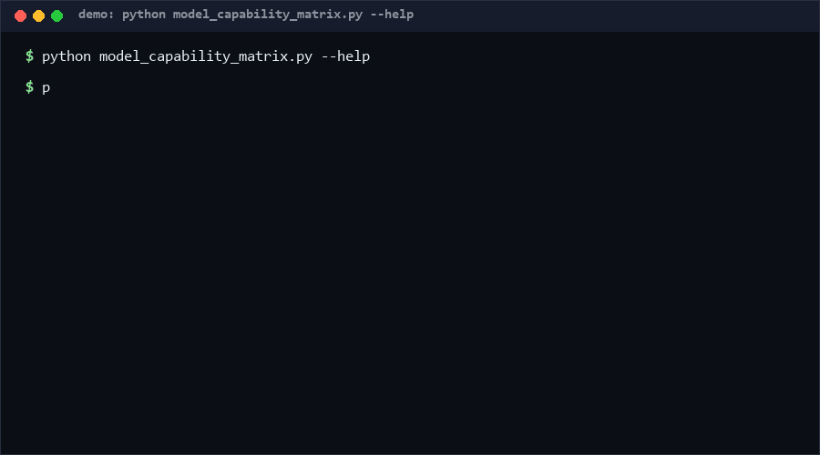

# model-capability-matrix

A versioned, machine-readable capability matrix for AI models: declare what each model can do in a typed JSON schema, then validate, merge overlays with conflict detection, diff releases, and export comparison tables. Pure standard library, offline.

<p align="center"></p>

## Problem

Teams track "which model supports what" in wikis, tribal knowledge, and stale spreadsheets. Two sources say different context windows and nobody notices; a downgrade slips into the routing config; there is no diff, no history, no merge story between team-owned overlays. The fix is boring: one validated document per version, with tooling that refuses silent conflicts.

## How it works

A **matrix** is a JSON document (JSON is a subset of YAML 1.2, so the file remains YAML-tool readable):

```json
{"matrix_version": "2026.10.1",
 "models": {"model-a": {"capabilities": {"context_window": 128000, "vision": true, "json_mode": "strict"},
                        "as_of": "2026-09-01", "source": "vendor-docs"}}}
```

- **Typed capabilities** — `context_window`/`max_output` must be positive ints (booleans rejected even though `bool` subclasses `int`), six modality flags must be bools, `json_mode` is an enum.
- **Merge** — overlay wins per capability; every disagreeing value is reported as a conflict `{model, capability, base_value, overlay_value}` instead of being silently overwritten.
- **Diff & monotonic versions** — `diff_matrices` reports added/removed models and changed capabilities; `check_version_monotonic` rejects version downgrades (`2026.10.2 -> 2026.10.1`).
- **Export** — `export_table` renders a deterministic Markdown comparison table.

## Quickstart

```bash
# Validate a matrix (~0.05s [estimated, repro: time python model_capability_matrix.py validate m.json])
python model_capability_matrix.py validate matrix.json

# Merge a team overlay onto the base matrix, conflicts listed, result written out
python model_capability_matrix.py merge base.json overlay.json --out merged.json

# What changed between releases?
python model_capability_matrix.py diff v1.json v2.json

# Ask one question
python model_capability_matrix.py query matrix.json model-a context_window

# Full self-test, 50 checks (~0.3s [estimated, repro: time python self_test.py])
python self_test.py
```

## How this differs (why-not-X)

| Alternative | Stars* | How this repo differs |
|---|---|---|
| [seanliii/ai-model-capability-matrix](https://github.com/seanliii/ai-model-capability-matrix) | 0 | An AI-tool project by its author; this ships a typed schema, a merge/conflict detector, and monotonic-version enforcement as a runnable stdlib CLI rather than a curated content tool. |
| Vendor changelogs/blogs | n/a | Prose, per-vendor, no machine schema; this normalizes everything into one comparable document with a diff. |
| Hand-maintained spreadsheets | n/a | No validation, no merge, silent conflicts; this rejects bad types at load time and reports every disagreeing overlay value. |

\* Stars from the R13 precheck snapshot, as of 2026-10-11.

## Minimal Fallback

Without this tool: keep one JSON file per release and diff with `git diff` / `jq`. You lose type validation and conflict detection, but the data format stays identical — `jq '.models["model-a"].capabilities' matrix.json` answers the same questions the `query` subcommand does.

## Design Trade-offs

- **JSON over YAML** — zero dependencies and unambiguous types; YAML's convenience aliases are not worth a parser dependency.
- **Typed enum of capabilities, not free-form** — a closed vocabulary keeps merges meaningful; new capability kinds require a schema release (deliberate friction).
- **Overlay-wins merge, not three-way merge** — simple and auditable; simultaneous edits to the same value surface as conflicts for a human, not as auto-choices.
- **Dot-integer versions only** — comparison is total and deterministic; semver ranges/pre-tags are rejected rather than half-supported.

## Limits & Second-order Effects

- Values are *declarations*, not measurements: a wrong `context_window` is validated as well-typed nonsense. Second-order: teams may over-trust a validated matrix — pair it with the `source`/`as_of` fields and periodic re-checks.
- The capability set will lag the industry (agentic memory, audio out, etc. are absent); schema evolution itself needs versioning.
- Conflict detection only sees pairs both sides declare; a capability dropped by the overlay silently disappears.
- No auth/access model: the matrix claims nothing about who may edit it.

## FAQ

**Is the matrix data included?** No — this repo is the *spec + tooling*; you author the data for the models you use.

**Why reject booleans for `context_window` when `True == 1` in Python?** Because `isinstance(True, int)` is a famous Python trap; the validator treats it as a type error.

**Can two teams both be "right" in a conflict?** Often yes — that is why conflicts are reported, not resolved.

**When NOT to use this?** Do not use it as an authoritative source for routing or billing decisions without an independent verification loop; do not use it for capabilities that need quantitative benchmarking (quality, latency) — this tracks binary/enum declarations only; skip it if your team already has an LLM gateway that enforces capabilities at runtime.

## [Core Assumptions]

1. Capability facts change at human timescales (weeks), so versioned documents beat a live API for this purpose.
2. A closed capability vocabulary is acceptable; extensibility is traded for mergeability.
3. Matrix versions are comparable as dot-separated integer tuples.
4. Conflicts between overlays require human adjudication, not automatic resolution.

---

*Confidence: high — the schema and merge semantics are small, deterministic, and covered by a 50-check self-test; star counts from the R13 precheck snapshot. Content as of 2026-10-11.*

---

Part of the [zhengming-toolbox](https://github.com/chenhz01/zhengming-toolbox) — 55 purpose-built AI-engineering tools across neglected niches.

Related tools: [model-arbitration-spec](https://github.com/chenhz01/model-arbitration-spec) · [embedding-drift-watch](https://github.com/chenhz01/embedding-drift-watch) · [vector-meta-schema](https://github.com/chenhz01/vector-meta-schema)
